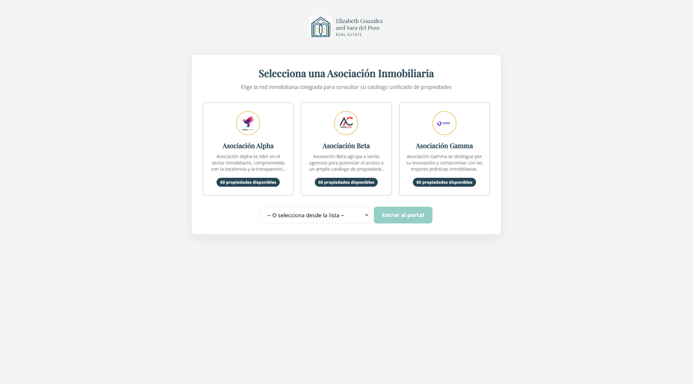
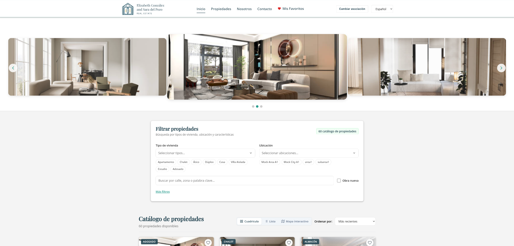
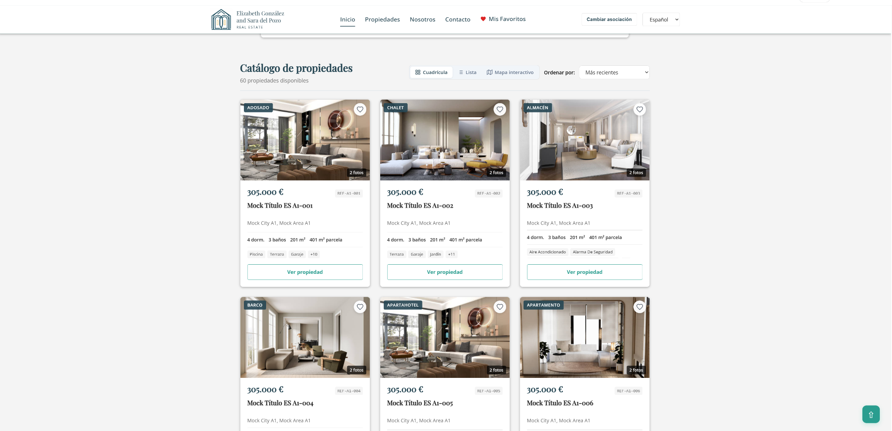

# 🏡 Real Estate MLS Platform

[](https://react.dev/)
[](https://vitejs.dev/)
[](https://reactrouter.com/)
[](https://www.i18next.com/)
[](https://github.com/Sppgg/real-estate-mls-platform/actions/workflows/ci.yml)
[](LICENSE)

**Real Estate MLS Platform** is a modern, interactive web application for browsing, filtering, and managing real estate listings. Designed for real estate agencies and Multiple Listing Service (MLS) networks, it provides an intuitive experience for prospective buyers and real estate agents alike.

---

## 📸 Screenshots

### Association selection

Choose an MLS association to explore its property catalog.



### Home page and property search

Browse featured listings and use the search panel to filter available properties.



### Property catalog — grid view

Explore property cards, key details, and favorites in the grid layout.



> **Note:** The screenshots show sample property listings and demonstration data.

---

## 🌟 Key Features

- **🏢 Multi-Association Support**: Supports multiple real estate networks (e.g., Costa del Sol Real Estate MLS), each with its own branding, contact details, and property catalog.
- **🔍 Advanced Search and Filtering**:
  - Multi-select location picker with autocomplete and real-time search.
  - Multi-select property type picker (apartments, villas, penthouses, detached houses, and more).
  - Filters for price range, bedrooms, bathrooms, and amenities such as swimming pools, terraces, garages, elevators, and sea views.
- **👁️ Three Property Catalog Views**:
  - **Grid View**: Image-focused property cards with property-type and new-build labels, key details, and quick access to listings.
  - **List View**: Horizontal cards with expanded details to help users compare properties.
  - **Interactive Map (Map Discovery)**: A simulated interactive map with location markers, area-based filtering, zoom and pan controls, and links to Google Maps without exposing precise property locations.
- **📋 Detailed Property Pages**:
  - Available both as a modal and as a standalone page with a dedicated permalink (`/association/:id/properties/:propertyId`).
  - Interactive image gallery.
  - Property specifications, including built area, plot size, terrace area, and year of construction.
  - Detailed expenses and taxes (community fees, IBI/property tax, waste collection fees), plus energy efficiency ratings (energy consumption and CO₂ emissions).
  - Agency contact form for inquiries and viewing requests.
- **🕒 Recently Viewed Properties**: Stores the last three viewed properties in `sessionStorage` for the current browsing session.
- **❤️ Favorites**:
  - Save properties using an animated heart icon on listing cards and property details.
  - Persist favorites in `localStorage` across visits in the same browser.
  - Manage saved properties on a dedicated page (`/association/:id/favorites`).
- **🌐 Internationalization (i18n)**: Full Spanish and English language support, with instant language switching without page reloads.
- **📱 Responsive Design**: Optimized for mobile, tablet, and desktop screens, with navigation adapted to touchscreens and larger displays.

---

## 🛠️ Tech Stack

| Category | Technology | Purpose |
| :--- | :--- | :--- |
| **UI Library** | [React 19](https://react.dev/) | Component-based rendering with functional components and Hooks. |
| **Build Tool** | [Vite 6](https://vite.dev/) | Fast development environment with SWC Fast Refresh support. |
| **Routing** | [React Router v7](https://reactrouter.com/) | Declarative routing, nested routes, and URL parameters. |
| **Internationalization** | [i18next](https://www.i18next.com/) & [react-i18next](https://react.i18next.com/) | Translation resources, interpolation, and dynamic language switching. |
| **State Management** | React Context API | Shared state for associations, favorites, and property listings. |
| **Client-Side Storage** | `localStorage` & `sessionStorage` | Persistent favorites and session-based recently viewed history. |
| **Styling** | Modular CSS3 & CSS Custom Properties | Consistent design system without heavy CSS framework dependencies. |
| **Code Quality** | [ESLint v9](https://eslint.org/) | Static analysis and React Hooks best practices. |

---

## 📁 Project Structure

```text
real-estate-mls-platform/
├── public/                         # Public assets (logos, favicon, images)
│   ├── favicon.png
│   ├── logocostadelsol.png
│   └── mock/                       # Fallback mock data
├── src/
│   ├── assets/                     # Additional visual assets
│   ├── components/                 # Reusable UI components
│   │   ├── BrandLogo.jsx           # Association-specific branding
│   │   ├── CarouselHomeComponent.jsx # Featured homepage carousel
│   │   ├── FooterComponent.jsx     # Footer and legal links
│   │   ├── LanguageSelectorComponent.jsx # ES/EN language selector
│   │   ├── MultiLocationSelector.jsx # Multi-select location picker
│   │   ├── MultiTypeSelector.jsx   # Multi-select property types
│   │   ├── PropertyCard.jsx        # Property cards (Grid/List)
│   │   ├── PropertyDetailModal.jsx # Property details modal
│   │   ├── PropertyFilterComponent.jsx # Advanced filter panel
│   │   ├── PropertyList.jsx        # Catalog (Grid/List/Map)
│   │   ├── RecentlyViewedSection.jsx # Recently viewed properties
│   │   ├── ScrollToTopComponent.jsx # Back-to-top button
│   │   ├── header/                 # Header and navigation
│   │   ├── layouts/                # Main application layout
│   │   └── map/                    # Interactive map components
│   │       ├── PropertyMapDiscovery.jsx # Map-based property discovery
│   │       └── PropertyLocationMap.jsx # Map on property detail pages
│   ├── context/                    # React Context providers
│   │   ├── AllAssociationsContext.jsx # Available associations
│   │   ├── AssociationContext.jsx  # Active association
│   │   ├── FavoritesContext.jsx    # Favorites state and persistence
│   │   └── PropertiesContext.jsx   # Property listing state
│   ├── customHook/                 # Reusable React Hooks
│   ├── pages/                      # Application pages
│   │   ├── AboutUsPage.jsx         # About page
│   │   ├── AssociationSelectorPage.jsx # Association selection
│   │   ├── ContactPage.jsx         # General contact form
│   │   ├── CookiesPolicyPage.jsx   # Cookie policy
│   │   ├── DataProtectionPage.jsx  # Data protection / GDPR
│   │   ├── FavoritesPage.jsx       # Saved properties
│   │   ├── HomePage.jsx            # Homepage and property catalog
│   │   ├── LegalNoticePage.jsx     # Legal notice
│   │   └── PropertyDetailPage.jsx  # Individual property page
│   ├── services/                   # Mock data and data services
│   │   ├── associationData.jsx     # Association configurations
│   │   └── propertiesData.jsx      # Sample property listings
│   ├── styles/                     # Modular CSS files
│   │   ├── header.css
│   │   ├── propertyCard.css
│   │   ├── propertyList.css
│   │   ├── propertyMap.css
│   │   └── ...
│   ├── utils/                      # Utility functions
│   │   └── recentlyViewedStorage.js # Session history helpers
│   ├── App.css                     # Global design tokens and styles
│   ├── App.jsx                     # Application routes
│   ├── i18n.js                     # ES/EN translation resources
│   └── main.jsx                    # React entry point
├── index.html                      # HTML entry point
├── metadata.json                   # Project metadata
├── package.json                    # Dependencies and scripts
├── package-lock.json               # npm dependency lockfile
├── vite.config.js                  # Vite configuration
└── README.md                       # Project documentation
```

---

## 🚀 Requirements and Installation

### Prerequisites

- **Node.js**: A compatible version of Node.js installed ([download Node.js](https://nodejs.org/)). Node.js 22 is used in the project's CI workflow.
- **npm** (included with Node.js).

### Step 1: Clone the repository

```bash
git clone https://github.com/Sppgg/real-estate-mls-platform.git
cd real-estate-mls-platform
```

### Step 2: Install dependencies

```bash
npm ci
```

### Step 3: Start the development server

```bash
npm run dev
```

Open your browser at:

```text
http://localhost:3000
```

---

## 📜 Available Scripts

The following commands are defined in `package.json`:

| Command | Description |
| :--- | :--- |
| `npm run dev` | Starts the Vite development server on port `3000`. |
| `npm run build` | Creates an optimized production build in `dist/`. |
| `npm run preview` | Serves the production build locally for preview. |
| `npm run lint` | Runs ESLint to check code quality and React best practices. |

---

## 📖 User Guide

1. **Select an Association**
   - On the homepage (`/`), choose the real estate association or network you want to explore (for example, *Costa del Sol MLS*).
2. **Search and Filter Properties**
   - Use the filter bar to narrow your results:
     - Open **Location** to select one or more cities or areas, or search by name.
     - Open **Property Type** to select apartments, villas, penthouses, and other property types.
     - Set your desired price range and minimum numbers of bedrooms and bathrooms.
     - Select **More Filters** to filter for new builds or amenities such as a pool, garage, terrace, or garden.
     - Select **Apply Filters** to update results or **Clear Filters** to reset your search.
3. **Switch Between Catalog Views**
   - Use the view selector above the property listings:
     - **Grid**: Browse image-rich cards.
     - **List**: Compare properties in detailed horizontal rows.
     - **Map**: Explore properties by area and select markers to preview listings.
4. **View Property Details**
   - Select a listing to open its details in a modal or dedicated page.
   - Browse photos, property specifications, fees, taxes, and an approximate location map.
   - Find the **Recently Viewed** section with the latest properties visited during your session.
5. **Save Favorites**
   - Select the heart icon on any listing or detail page to add a property to your favorites.
   - Open **My Favorites** from the navigation menu to revisit saved properties, even after closing the browser.
6. **Change Language**
   - Use the language selector in the upper-right navigation to switch between **Español (ES)** and **English (EN)** at any time.

---

## 📄 License

This project is licensed under the **MIT License**. See [LICENSE](LICENSE) for details.

---

Developed for **Real Estate MLS Platform**.
